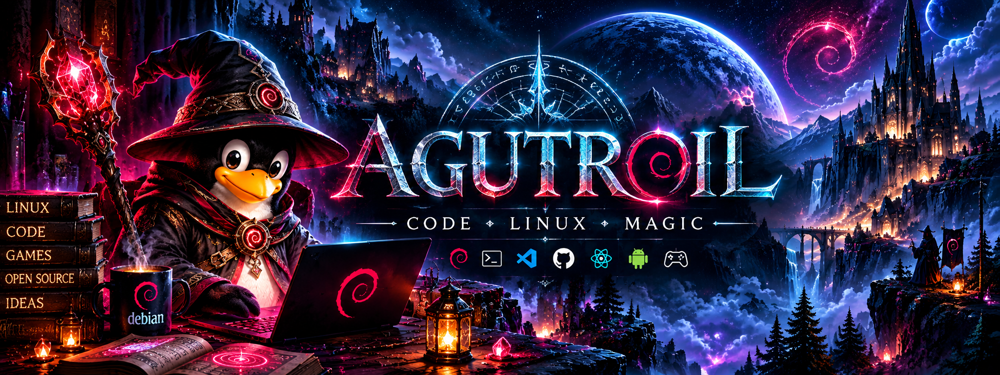

<!--
=============================================================================
  AGUTROIL · GITHUB PROFILE README
  Anton Deister
=============================================================================

Expected repository structure:

Agutroil/
├── README.md
└── assets/
    ├── banner.png
    ├── antondeister.png
    └── agutroil-banner.png

GitHub paths are case-sensitive.
=============================================================================
-->

  

<h1 align="center">🧙‍♂️ Anton Deister</h1>

  <strong>Developer · Linux Enthusiast · Game Developer · Systems & Technology</strong> 
  <code>@Agutroil</code>

  <em>Building software, worlds and tools — powered by Linux, shaped by curiosity and a little magic.</em>

  
  
  

  
  
  
  
  

---

## 👋 Über mich

<table>
<tr>
<td width="67%" valign="top">

Hallo! Ich bin **Anton Deister** – auf GitHub unterwegs als **Agutroil**.

Ich entwickle Software, experimentiere mit Linux und arbeite an eigenen Projekten rund um Games, Web, Security, Automatisierung und moderne Entwicklungswerkzeuge.

Besonders spannend finde ich Projekte, bei denen aus einer Idee Schritt für Schritt ein funktionierendes, testbares und erweiterbares System entsteht.

### ✦ Meine Schwerpunkte

  <strong>💻 Softwareentwicklung</strong> 
  Von der Idee bis zu funktionierenden, wartbaren Anwendungen und technischen Systemen.

  <strong>🐧 Linux & Debian</strong> 
  Debian als tägliche Entwicklungsumgebung mit Shell, CLI-Workflows und technischem Systemverständnis.

  <strong>🎮 Game Development</strong> 
  Gameplay-Systeme, Welten, Multiplayer, Progression und langfristig erweiterbare Spielarchitektur.

  <strong>🌐 Web Development</strong> 
  Moderne Websites und Webanwendungen mit Fokus auf klare Strukturen, Bedienbarkeit und technische Qualität.

  <strong>🔐 Security-focused Development</strong> 
  Sicherheit als Bestandteil der Architektur – von Eingabevalidierung bis zu Netzwerk- und Zugriffskontrollen.

  <strong>🤖 AI-assisted Development</strong> 
  Coding Agents und KI-Werkzeuge als kontrollierte Unterstützung innerhalb realer Entwicklungsprozesse.

  <strong>⚙️ Automatisierung</strong> 
  Wiederkehrende Aufgaben durch Skripte, Pipelines und reproduzierbare Workflows vereinfachen.

  <strong>🧪 Testing & Validation</strong> 
  Automatisierte Tests, Regression Checks und klare Qualitäts-Gates für verlässliche Änderungen.

  <strong>🏗️ Software Architecture</strong> 
  Systeme modular planen, Verantwortlichkeiten sauber trennen und Erweiterbarkeit langfristig erhalten.

  <strong>🛠️ Developer Tools</strong> 
  Eigene Werkzeuge, Bridges und Hilfssysteme entwickeln, die Entwicklungsabläufe schneller und sicherer machen.

Ich möchte Technologien nicht nur benutzen, sondern verstehen, verändern und daraus eigene Systeme bauen.

</td>
<td width="33%" align="center" valign="top">

<h3>Anton Deister</h3>

<code>@Agutroil</code>

Developer · Linux · Games · Technology

<kbd>🐧 Linux</kbd> <kbd>🎮 Games</kbd>

<kbd>💻 Development</kbd> <kbd>🔐 Security</kbd>

<kbd>🤖 AI</kbd> <kbd>⚙️ Automation</kbd>

</td>
</tr>
</table>

---

# 🧰 Technology Stack

<table>
<tr>
<td width="33%" valign="top">

### 🐧 System

  
  
  
  

</td>
<td width="33%" valign="top">

### 🎮 Game Development

  
  
  
  

</td>
<td width="33%" valign="top">

### 💻 Programming

  
  
  
  

</td>
</tr>
<tr>
<td width="33%" valign="top">

### 🌐 Web

  
  
  
  
  

</td>
<td width="33%" valign="top">

### 🔐 Systems

  
  
  
  
  

</td>
<td width="33%" valign="top">

### ⚙️ Development

  
  
  
  
  

</td>
</tr>
</table>

---

# 🚀 Development Areas

<table>
<tr>
<td width="50%" valign="top">

### 🎮 Game Development

Ich entwickle Spiele und Game-Systeme mit Fokus auf langfristig erweiterbare Architektur.

<strong>🌍 World Building</strong> Regionen, Städte, Dungeons und spielbare Räume so aufbauen, dass sie Orientierung, Atmosphäre und Gameplay verbinden.

<strong>🌐 Multiplayer</strong> Gemeinsame Spielwelten mit klaren Netzwerkgrenzen, persistentem Zustand und nachvollziehbarer Synchronisation.

<strong>⚔️ Combat-Systeme</strong> Kampfmechaniken mit Skills, Gegnerverhalten, Feedback, Trefferlogik und serverseitiger Autorität entwickeln.

<strong>🧙 Charakter-Systeme</strong> Attribute, Zustände, Builds und Charakterlogik modular und langfristig erweiterbar strukturieren.

<strong>📈 Skills & Progression</strong> Level, Erfahrung, Skill-Ränge und Freischaltungen zu einem nachvollziehbaren Fortschrittssystem verbinden.

<strong>🎒 Inventar & Equipment</strong> Items, Ausrüstung, Slots, Werte und persistente Inventardaten sauber miteinander verknüpfen.

<strong>📜 Quests</strong> Aufgaben, Dialoge, Ziele, Bedingungen und Belohnungen als datengetriebene Systeme umsetzen.

<strong>👹 Monster & Bosse</strong> Gegner-Archetypen, Spezialmechaniken und mehrphasige Begegnungen mit klarer Lesbarkeit entwickeln.

<strong>🏰 Dungeons</strong> Handgebaute Begegnungen, Bossräume, Fortschrittsregeln und Belohnungen zu eigenständigen Spielabschnitten verbinden.

<strong>⚡ Performance</strong> Gameplay und Präsentation so planen, dass auch ältere PCs und schwache integrierte Grafikeinheiten berücksichtigt werden.

<strong>🎨 Asset Pipelines</strong> Sprites, Icons, Modelle und Content über nachvollziehbare, reproduzierbare Asset-Workflows integrieren.

<strong>🛠️ Developer Tools</strong> Editor-Hilfen, Bridges, Validatoren und interne Werkzeuge entwickeln, die große Projekte beherrschbar halten.

</td>
<td width="50%" valign="top">

### 🌐 Software & Web

Ich beschäftige mich mit modernen Web- und Software-Technologien.

<strong>🐍 Python</strong> Automatisierung, Datenverarbeitung, Entwicklerwerkzeuge und technische Hilfsskripte.

<strong>🔷 TypeScript</strong> Typisierte Webanwendungen und größere Frontend-/Backend-Strukturen mit klaren Schnittstellen.

<strong>🟨 JavaScript</strong> Interaktive Weboberflächen, Client-Logik und browserbasierte Funktionen.

<strong>⚛️ React</strong> Komponentenbasierte Benutzeroberflächen mit wiederverwendbarer UI-Logik.

<strong>▲ Next.js</strong> Strukturierte React-Anwendungen mit Routing, Rendering und moderner Webarchitektur.

<strong>🐘 PHP</strong> Serverseitige Weblogik, klassische Webanwendungen und WordPress-nahe Entwicklung.

<strong>🌐 HTML</strong> Semantische Seitenstrukturen als stabile Grundlage für zugängliche Weboberflächen.

<strong>🎨 CSS</strong> Responsive Layouts, visuelle Systeme und klare Darstellung auf Desktop und Mobilgeräten.

<strong>🐬 MySQL</strong> Relationale Datenmodelle, persistente Anwendungsdaten und strukturierte Abfragen.

<strong>🔴 Redis</strong> Schnelle Zustände, Caching und temporäre Daten für vernetzte Anwendungen.

<strong>🔌 WebSockets</strong> Echtzeitkommunikation für Live-Updates, Messaging und interaktive Netzwerkfunktionen.

</td>
</tr>
<tr>
<td width="50%" valign="top">

### 🐧 Linux & Automation

Linux ist meine primäre Entwicklungsumgebung.

<strong>🌀 Debian</strong> Stabile tägliche Entwicklungsplattform für Programmierung, Tools, Server und Automatisierung.

<strong>🖥️ Shell</strong> Dateien, Prozesse, Builds und Entwicklungsabläufe direkt und effizient über die Kommandozeile steuern.

<strong>🔀 Git</strong> Änderungen nachvollziehbar versionieren, Branches sauber trennen und Entwicklungsstände sicher zusammenführen.

<strong>🐙 GitHub</strong> Repositories, Pull Requests, Issues, Actions und Projektpräsentation in einem zentralen Workflow verbinden.

<strong>⌨️ CLI-Workflows</strong> Wiederholbare Abläufe bewusst über Kommandozeilenwerkzeuge statt über manuelle Klickfolgen aufbauen.

<strong>🔄 CI</strong> Tests und Validierungen automatisiert bei Änderungen ausführen und Fehler früh sichtbar machen.

<strong>📦 Build-Pipelines</strong> Builds, Exporte und Prüfungen reproduzierbar von Quellcode bis Artefakt organisieren.

<strong>⚙️ Automatisierung</strong> Wiederkehrende technische Aufgaben durch Skripte und definierte Prozesse zuverlässig vereinfachen.

<strong>🛠️ lokale Developer Tools</strong> Eigene Hilfsprogramme und lokale Werkzeuge für Analyse, Validierung und Projektsteuerung entwickeln.

</td>
<td width="50%" valign="top">

### 🤖 AI-assisted Development

Mich interessiert besonders die Verbindung klassischer Softwareentwicklung mit modernen Coding Agents.

<strong>🤖 Coding Agents</strong> Agenten für konkrete Entwicklungsaufgaben einsetzen, ohne Kontrolle über Architektur, Tests und Änderungen abzugeben.

<strong>🌉 AI Tool Bridges</strong> Werkzeuge und Schnittstellen bauen, über die Agenten kontrolliert mit Entwicklungsumgebungen interagieren können.

<strong>🧪 automatisierte Tests</strong> Agent-generierte Änderungen konsequent durch reale Tests und Regression Checks absichern.

<strong>⚙️ Developer Automation</strong> Agenten mit bestehenden Git-, Build-, Test- und Tooling-Abläufen zu reproduzierbaren Prozessen verbinden.

<strong>🎨 Asset Pipelines</strong> Auch Content- und Asset-Arbeit strukturiert, validierbar und möglichst automatisierbar in den Workflow integrieren.

<strong>🔁 reproduzierbare Workflows</strong> Aufgaben so definieren, dass Schritte, Ergebnisse und Prüfungen nachvollziehbar wiederholt werden können.

<strong>✅ automatische Validierung</strong> Qualitäts-Gates einsetzen, die Ergebnisse unabhängig vom Agenten objektiv gegen definierte Regeln prüfen.

<strong>🧠 Agent-basierte Entwicklungsprozesse</strong> Menschen, Coding Agents, Git, Tests und Reviews zu einem kontrollierten Gesamtprozess verbinden.

</td>
</tr>
</table>

---

<h1 align="center">🌌 Current Focus — Nythara</h1>

  

<h2 align="center">A 2D MMORPG inside an immersive 3D fantasy world.</h2>

<em>Explore · Fight · Progress · Build · Connect</em>

  <strong>Nythara</strong> ist mein größtes aktuelles Game-Development-Projekt. 
  Das Spiel verbindet gerichtete 2D-Charaktere mit einer stilisierten 3D-Fantasywelt und wächst zu einem Online-RPG mit persistenten Charakteren, serverautoritativem Gameplay, Regionen, Dungeons und langfristiger Progression.

<table>
<tr>
<td width="50%" align="center" valign="top">

<h3>⚔️ Gameplay & World</h3>

<strong>🌍 Fantasy-Regionen</strong> Eigene Gebiete, Biome und miteinander verbundene Fantasy-Welten.

<strong>🌐 Multiplayer</strong> Gemeinsame Spielwelt mit persistenten Charakteren und serverseitiger Autorität.

<strong>⚔️ Combat</strong> Echtzeitkämpfe mit Skills, Gegner-Archetypen, Telegraphs und Bossmechaniken.

<strong>🌀 Portale & Reisen</strong> Reisen zwischen Regionen über Weltübergänge, Portale und freigeschaltete Wege.

<strong>👹 Monster & Bosse</strong> Unterschiedliche Kreaturen, Elite-Gegner und mehrphasige Bossbegegnungen.

<strong>🏰 Städte & Dungeons</strong> Städte, Quest-Hubs und handgebaute Dungeons mit eigener Progression.

<strong>🗡️ Items & Equipment</strong> Loot, Ausrüstung, Seltenheiten, Werte und sichtbare Equipment-Systeme.

<strong>🎒 Inventar</strong> Persistente Verwaltung von Items, Ausrüstung, Materialien und Belohnungen.

<strong>🧙 Charakter-Systeme</strong> Attribute, Builds, Charakterzustand und langfristige Entwicklung.

<strong>📈 Skills & Progression</strong> XP, Level, Skill-Ränge, Loadouts und freischaltbare Charakterentwicklung.

<strong>📜 Quests</strong> NPCs, Dialoge, Ziele, Freischaltungen und persistente Quest-Fortschritte.

<strong>💰 Economy</strong> Sammeln, Crafting, Händler, Währung und ein wachsender Item-Kreislauf.

</td>
<td width="50%" align="center" valign="top">

<h3>🧰 Technology & Development</h3>

<strong>🎮 Godot 4.7.2</strong> Die zentrale Engine für Gameplay, Welt, UI und Multiplayer.

<strong>📜 GDScript</strong> Gameplay-Systeme, Tools, Tests und Runtime-Logik.

<strong>🌐 ENet Multiplayer</strong> Netzwerkbasis für echte Clients, Server-Sessions und gemeinsame Welten.

<strong>🛡️ Server Authority</strong> Serverseitige Kontrolle über Combat, Fortschritt, Weltzustand und Charakterdaten.

<strong>🖥️ GL Compatibility</strong> Breite Hardware-Unterstützung mit Fokus auf ältere PCs und schwache iGPUs.

<strong>🎨 Asset Management</strong> Zentrale Verwaltung von Sprites, Icons, Equipment und Welt-Assets.

<strong>🧩 Content Pipelines</strong> Strukturierte Daten für Items, Monster, Loot, Regionen und Gameplay-Content.

<strong>🧪 Automated Testing</strong> Umfangreiche automatisierte Gameplay-, Netzwerk-, World- und Regressionstests.

<strong>🌉 AI Bridge</strong> Werkzeuge für kontrollierte Agent-Interaktion mit Godot und Entwicklungsabläufen.

<strong>🤖 Coding Agents</strong> Agent-gestützte Entwicklung innerhalb eines testbaren Git- und Review-Workflows.

<strong>🔄 CI</strong> Automatische Validierung und Qualitäts-Gates über GitHub Actions.

<strong>⚡ Low-End Performance</strong> Ressourcenschonende Architektur, skalierbare Präsentation und bewusst begrenzte Effekte.

</td>
</tr>
</table>

<table>
<tr>
<td align="center">

<strong>ℹ️ Mehr über Nythara</strong>  
Weitere Informationen, aktuelle Entwicklung, Welt, Kreaturen, Dungeons und Datenbank findest du auf der offiziellen Nythara-Webseite.  
<a href="https://agutroil.github.io/Nythara/"><strong>→ Nythara-Webseite öffnen</strong></a>

</td>
</tr>
</table>

---

  

<h2 align="center"><em>“Every bug is just an undocumented spell.”</em></h2>

  <strong>— Agutroil</strong>

