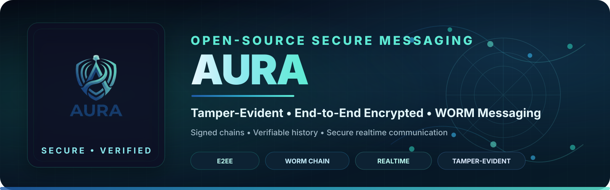

<p align="center">
  <a href="https://agutroil.github.io/">
    
  </a>
</p>

<h1 align="center">Anton Deister · Agutroil</h1>

<p align="center">
  <strong>Developer · Creator · Builder</strong>
</p>

<p align="center">
  🐧 Linux &nbsp;·&nbsp;
  💻 Software &nbsp;·&nbsp;
  🎮 Games &nbsp;·&nbsp;
  🔐 Security &nbsp;·&nbsp;
  🌍 Open Source
</p>

<p align="center">
  <strong>Code. Linux. Magic.</strong>
</p>

<p align="center">
  <a href="https://agutroil.github.io/">
    
  </a>

  <a href="https://github.com/Agutroil">
    
  </a>

  <a href="https://github.com/Agutroil/Aura">
    
  </a>
</p>

<p align="center">
  

  

  
</p>

---

## 🌐 About this repository

This repository contains the source code for my personal developer website:

### **https://agutroil.github.io/**

I'm **Anton Deister**, also known as **[@Agutroil](https://github.com/Agutroil)**.

The website is my central place for presenting my work around:

- 🐧 Linux & Debian
- 💻 Software Development
- 🎮 Game Development
- 🌐 Web Development
- 🔐 Security-focused Development
- 💬 Secure & Realtime Messaging
- 🌍 Open Source
- ⚙️ Automation
- 🤖 AI-assisted Developer Workflows

The goal is simple:

> Build things, understand how they work, improve them and share the results.

---

## ✨ Website highlights

The site includes:

- 👤 Developer profile and introduction
- 🛠️ Selected projects
- 🔐 Aura secure-messaging project
- 🧰 Technology stack
- 🌍 Open-source work
- 🎮 Game development
- 🌐 Web development
- 🔒 Security-focused development
- 💬 Realtime communication
- 🐧 Linux-focused workflows
- 🤖 AI-assisted development
- 🔗 Direct links to GitHub projects
- 📱 Responsive layout
- 🔎 Search-engine metadata
- 🔗 Open Graph / social preview metadata
- 🧩 Structured profile data

---

## 🚀 Live website

<p align="center">
  <a href="https://agutroil.github.io/">
    <strong>🌐 Visit agutroil.github.io →</strong>
  </a>
</p>

No installation is required to view the website.

---

## 🧰 Tech stack

### Frontend


### Development


### Security & Realtime


### Hosting


The site intentionally stays lightweight and does not require a frontend framework or application runtime.

---

## 📂 Project structure

```text
agutroil.github.io/
├── assets/
│   ├── banner.png
│   ├── antondeister.png
│   ├── aura-banner.svg
│   └── ...
│
├── index.html
└── README.md
```

`index.html` contains the website structure and presentation, while `assets/` contains the visual resources used by the site.

The Aura section uses:

```text
assets/aura-banner.svg
```

for the featured project presentation.

---

## 💻 Run locally

Because this is a static website, no complex setup is required.

Clone the repository:

```bash
git clone https://github.com/Agutroil/agutroil.github.io.git
cd agutroil.github.io
```

You can open `index.html` directly in your browser.

For a local HTTP server, use for example:

```bash
python3 -m http.server 8000
```

Then open:

```text
http://localhost:8000
```

---

## 🚀 Deployment

The website is published through **GitHub Pages**.

Repository:

```text
https://github.com/Agutroil/agutroil.github.io
```

Live site:

```text
https://agutroil.github.io/
```

Changes pushed to the configured GitHub Pages source are reflected on the public website after deployment.

---

## 🛠️ Selected work

### 🌌 Nythara

**Open-source fantasy MMORPG built with Godot.**

A game-development project focused on large fantasy worlds, multiplayer systems and scalable game architecture.

**Focus**

- Godot 4
- GDScript
- Multiplayer
- Server-authoritative architecture
- World Building
- Combat
- Regions & Dungeons
- Open Source

[**Explore Nythara →**](https://github.com/Agutroil/Nythara)

---

### 🔐 Aura

<p align="center">
  <a href="https://github.com/Agutroil/Aura">
    
  </a>
</p>

**Open-source secure messaging project focused on privacy, verifiable identities and tamper-evident communication.**

Aura is a security-focused realtime messaging application built around a clear separation between encrypted message content, authenticated identities and verifiable message history.

**Focus**

- 🔒 End-to-End Encryption
- 🛡️ Identity Verification
- 🔗 Tamper-Evident History
- ✍️ Signed Message History
- 💬 Realtime Messaging
- 👥 Group Conversations
- 🔎 Message Search
- 📱 Responsive Mobile UI
- 🔐 Safety Numbers
- 🧪 Automated Security Testing
- 🌍 Open Source

**Technology**

- Next.js
- React
- TypeScript
- WebSockets
- MySQL / MariaDB
- Redis
- Vitest
- Playwright
- GitHub Actions

<p align="center">
  <a href="https://github.com/Agutroil/Aura">
    
  </a>
</p>

<p align="center">
  

  

  
</p>

> [!IMPORTANT]
> Aura is an actively developed security-focused project. While the project includes extensive automated security, integration and end-to-end testing, it has not yet undergone an independent professional security audit.

[**Explore Aura →**](https://github.com/Agutroil/Aura)

---

### 🏰 Astra Kingdom

**Open-source game development project.**

Focused on:

- Combat systems
- Progression
- Equipment
- Long-term gameplay systems
- Game mechanics
- Experimentation

---

### 🩺 MedCore

**Open-source healthcare software project.**

Focused on modern medical and health-related workflows with a modular web architecture.

**Tech**

- React
- Next.js
- TypeScript
- Modern Web UI
- Security & Privacy
- Modular Architecture

[**Explore MedCore →**](https://github.com/Agutroil/medcore)

---

### 📰 Blog Pulse

**Modern open-source WordPress theme for blogs and magazines.**

Features include:

- WordPress
- PHP
- Full Site Editing
- Responsive Design
- Dark Mode
- Block Patterns
- Design Tokens

[**Explore Blog Pulse →**](https://github.com/Agutroil/blog-pulse)

---

## 🔬 What I'm currently exploring

```text
🎮 Game Development
🔐 Secure Messaging
🔒 Security-focused Development
💬 Realtime Communication
🌍 Open Source
🐧 Linux & Debian
🌐 Web Technologies
⚙️ Automation
🤖 Coding Agents
🧠 AI-assisted Development
🧰 Developer Tools
```

Current projects include:

- 🌌 **Nythara** — fantasy game development with Godot
- 🔐 **Aura** — secure realtime messaging
- 🩺 **MedCore** — healthcare-oriented web software
- 📰 **Blog Pulse** — open-source WordPress development

---

## 🧙 About Agutroil

**Agutroil** is my developer identity for projects around software, Linux, games, web development, security and open source.

I enjoy building systems from the ground up, experimenting with technology and turning ideas into functional projects.

Projects such as **Nythara**, **Aura**, **MedCore** and **Blog Pulse** explore different areas of software development — from game architecture and multiplayer systems to secure communication and modern web development.

My development philosophy:

> **Every bug is just an undocumented spell.**

And my workflow:

```text
Build → Test → Understand → Improve → Share
```

---

## 🔗 Connect

<p align="center">
  <a href="https://github.com/Agutroil">
    
  </a>

  <a href="https://agutroil.github.io/">
    
  </a>
</p>

<p align="center">
  <a href="https://github.com/Agutroil/Nythara">
    <strong>🎮 Nythara</strong>
  </a>

  &nbsp; • &nbsp;

  <a href="https://github.com/Agutroil/Aura">
    <strong>🔐 Aura</strong>
  </a>

  &nbsp; • &nbsp;

  <a href="https://github.com/Agutroil/medcore">
    <strong>🩺 MedCore</strong>
  </a>

  &nbsp; • &nbsp;

  <a href="https://github.com/Agutroil/blog-pulse">
    <strong>📰 Blog Pulse</strong>
  </a>
</p>

<p align="center">
  <a href="https://github.com/Agutroil?tab=repositories">
    <strong>🚀 View all repositories →</strong>
  </a>
</p>

---

## 🤝 Feedback

This is my personal developer website, but bug reports, broken-link reports and technical suggestions are welcome.

If you find an issue with the site, feel free to open an issue in this repository.

---

## 👤 Maintainer

**Anton Deister · Agutroil**

Developer · Linux Enthusiast · Open-Source Creator

- GitHub: [@Agutroil](https://github.com/Agutroil)
- Website: [agutroil.github.io](https://agutroil.github.io/)
- Aura: [github.com/Agutroil/Aura](https://github.com/Agutroil/Aura)

---

<p align="center">
  🐧 <strong>Powered by Linux</strong>
  &nbsp; · &nbsp;
  ✦
  &nbsp; · &nbsp;
  🪶 <strong>Crafted by Agutroil</strong>
</p>

<p align="center">
  <strong>💻 Code · 🐧 Linux · 🎮 Games · 🔐 Security · 🌍 Open Source · 🪄 Magic</strong>
</p>

<p align="center">
  <strong>Code. Linux. Magic.</strong>
</p>

<p align="center">
  <sub>© 2026 Anton Deister · Agutroil</sub>
</p>
